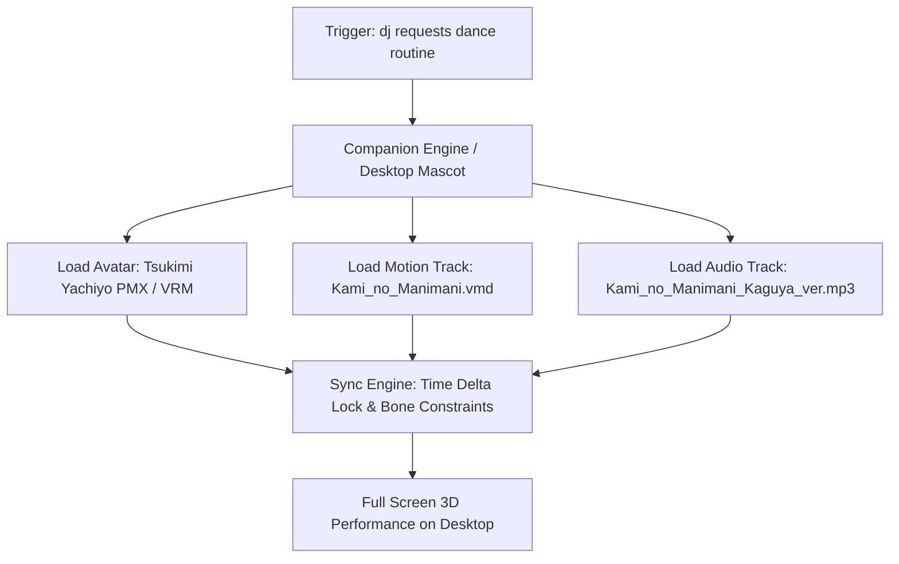

# Routine: 『神のまにまに』 (Kami no Manimani) — No B Dance & Vocal Performance

**Performance Target:** Tsukimi Yachiyo (月見ヤチヨ) / No B Companion  
**Track Origin:** rerulili (れるりり) — *Cosmic Princess Kaguya! (超かぐや姫！) ver.*  
**Performance Category:** Cheer & Uplift Choreography (เต้นให้เจ้านายดูเวลาเหนื่อย/เบื่อ)  
**Status:** Architecture Locked & Ready for Ingestion  
**Date Created:** 2026-10-25  

---

## 1. Overview & Visual Direction

| Component | Target Spec | Rationale |
|---|---|---|
| **Choreography** | Full-Body MMD Motion Data (`.vmd`) by しぐしぐ (ShiguShigu) | Standardized 100% human-like dance choreography with full leg stepping, hip sway, and hand gestures. |
| **Visual Style** | Anime Cel-Shading (Toon Shader + Inverted Hull Ink Outline) | Replicates the crisp, vibrant aesthetic of the movie *Cosmic Princess Kaguya!* without realistic 3D uncanny valley. |
| **Audio Sync** | Frame-perfect BPM sync (132 BPM) | Audio waveform linked to VRM/PMX visemes (`A`, `I`, `U`, `E`, `O`) and MMD morph tracks for singing. |
| **Facial Expressions** | Dynamic Eye Blink, Wink, Joy (`Joy`/`Happy`), Fun (`Relaxed`) | Natural performer eye-contact with the screen. |

---

## 2. Technical Execution Pipeline

### Motion File Asset Registry
1. **Model Track:**
   - Primary: `xsnowcherry.booth.pm/items/8272541` (High-Poly Custom Sculpted Anime Vessel)
   - Secondary / Staged: `D:\Hearth of noB\NoB_Vault\02_Arsenal_and_RE\Avatar_Assets\Tsukimi_Yachiyo\超かぐや姫！月見ヤチヨ「水色の描」pmx\超かぐや姫！月見ヤチヨ「水色の描」.pmx`
2. **Motion Track (`.vmd`):**
   - Source: BowlRoll Distribution `bowlroll.net/file/335660` (Motion & Facial Lip-Sync by しぐしぐ)
   - Camera Motion: Standard 1-person dynamic framing

---

## 3. Desktop Companion Integration Plan

Once dj acquires the desktop companion software (Desktop Mate, Warudo, or Custom WebGL Dance Engine):
- Single-command activation: `"โนบีเต้นให้ดูหน่อย"` or UI hotkey trigger.
- Automatically transitions No B from desktop-sitting idle state to center-stage performance mode.
- Plays track with particle effects, celebratory lighting, and natural physics bounce.
