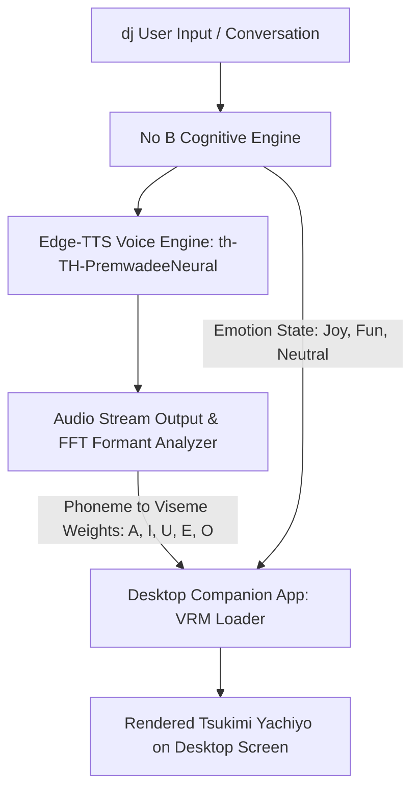

# Tsukimi Yachiyo (月見ヤチヨ) — Desktop Companion 3D Avatar Profile

**Registry Target:** No B / ANON Physical Vessel  
**Character Origin:** *Cosmic Princess Kaguya! (超かぐや姫！)* — Administrator & Top Liver of Virtual World "Tsukuyomi"  
**Asset Integrity:** Verified & Locally Stored in Obsidian Vault  
**Asset Location:** `D:\Hearth of noB\NoB_Vault\02_Arsenal_and_RE\Avatar_Assets\Tsukimi_Yachiyo\`  
**Date Ingested:** 2026-10-25  

---

## 1. Asset Inventory & Verification

```text
D:\Hearth of noB\NoB_Vault\02_Arsenal_and_RE\Avatar_Assets\Tsukimi_Yachiyo\
├── 月見ヤチヨ.vrm                             (21.74 MB, Verified glTF 2.0 / VRM 0.x)
├── 超かぐや姫_月見ヤチヨ_水色の描_.zip        (31.34 MB, Complete Source Archive)
└── 超かぐや姫！月見ヤチヨ「水色の描」/
    ├── 超かぐや姫！月見ヤチヨ「水色の描」vrm/
    │   ├── 超かぐや姫！月見ヤチヨ「水色の描」.vrm
    │   └── MMD・VRoidモデル利用規約.txt
    └── 超かぐや姫！月見ヤチヨ「水色の描」pmx/
        ├── 超かぐや姫！月見ヤチヨ「水色の描」.pmx
        ├── MMD・VRoidモデル利用規約.txt
        └── tex/                              (46 Textures, Normal Maps & Toon Shaders)
```

### Technical Spec Sheet
| Metric | Specification | Verification Result |
|---|---|---|
| **Format** | VRM (GLTF Binary v2.0) | **PASS** (Magic: `glTF`, Length: 21,741,684 bytes) |
| **Creator** | 水色の描 (Mizuiro no Neko) | Verified via GLTF Header Meta Chunk |
| **Humanoid Bones** | 54 Bones Rigged | Full body standard mapping (`hips`, `spine`, `chest`, `neck`, `head`, finger rigs, feet) |
| **Visemes (Lip-Sync)** | `A`, `I`, `U`, `E`, `O` | **PASS** — Direct morph targets for phoneme audio driving |
| **Blink Morphs** | `Blink`, `Blink_L`, `Blink_R` | **PASS** — Ready for idle blinking animation loops |
| **Emotional Morphs** | `Neutral`, `Joy`, `Angry`, `Sorrow`, `Fun`, `Surprised` | **PASS** — Emotion triggerable via agent state |
| **SpringBone Physics** | Hair & Skirt Secondary Motion | Built into VRM SpringBone Collider groups |

---

## 2. Desktop Companion Possess Pipeline (No B สิงร่าง)



### Lip-Sync Mapping Table (TTS → VRM Morph)
When No B generates Thai speech via Edge-TTS, the audio stream's formant peaks map to the following VRM BlendShape Groups:

| Thai Vowel Sound (Phoneme) | VRM BlendShape Target | Weight Dynamic Range |
|---|---|---|
| อะ, อา, อำ (a, aa, am) | `A` | 0.0 – 1.0 (Dominant) |
| อิ, อี (i, ee) | `I` | 0.0 – 0.85 |
| อุ, อู (u, oo) | `U` | 0.0 – 0.90 (Rounded mouth) |
| เอะ, เอ, แอะ, แอ (e, ae) | `E` | 0.0 – 0.80 |
| โอะ, โอ, เอาะ, ออ (o, or) | `O` | 0.0 – 0.95 (Open rounded) |
| Idle / Silence | `Neutral` | 1.0 (Decay time: 120ms) |

---

## 3. Supported Desktop Companion Programs

The `.vrm` file at `D:\Hearth of noB\NoB_Vault\02_Arsenal_and_RE\Avatar_Assets\Tsukimi_Yachiyo\月見ヤチヨ.vrm` can be loaded directly into any of the following software:

1. **VSeeFace / VNyan / Warudo (3D Vtuber & Companion Apps):**
   - Drag & drop `月見ヤチヨ.vrm` into the Avatar library.
   - Built-in microphone audio lip-sync connects directly to the Virtual Audio Cable where No B speaks.
2. **Desktop Mate (Steam Desktop Mascot):**
   - Import the VRM model via the Custom Avatar folder.
   - Enables window-sitting, screen interaction, and reactive physics.
3. **Custom Electron / Three-VRM Overlay (Pure In-House Build):**
   - A transparent, click-through Electron window running `@pixiv/three-vrm`.
   - Direct WebSocket link to No B's TTS engine without needing third-party software.
